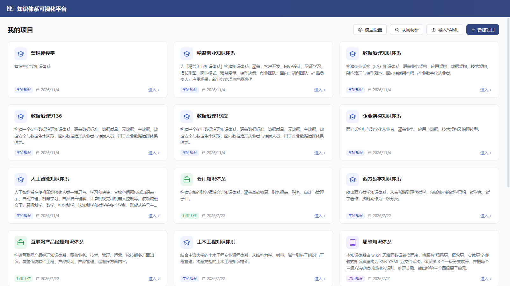
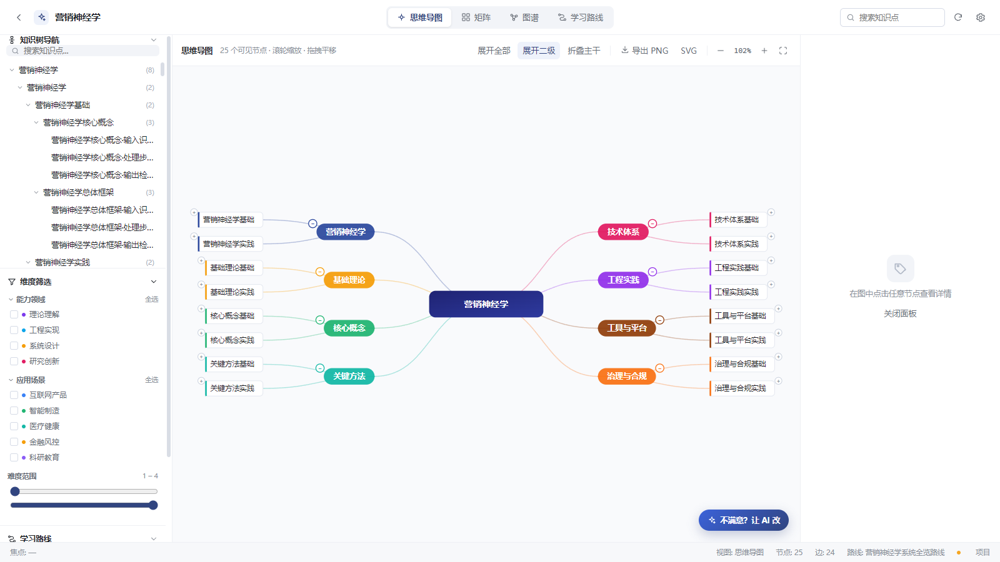
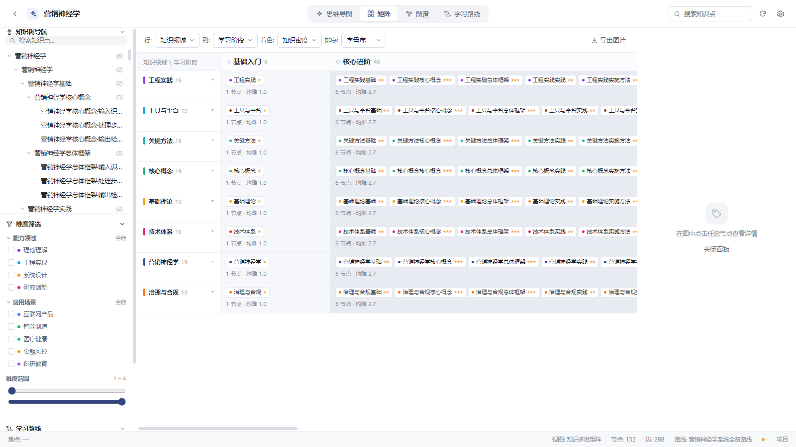
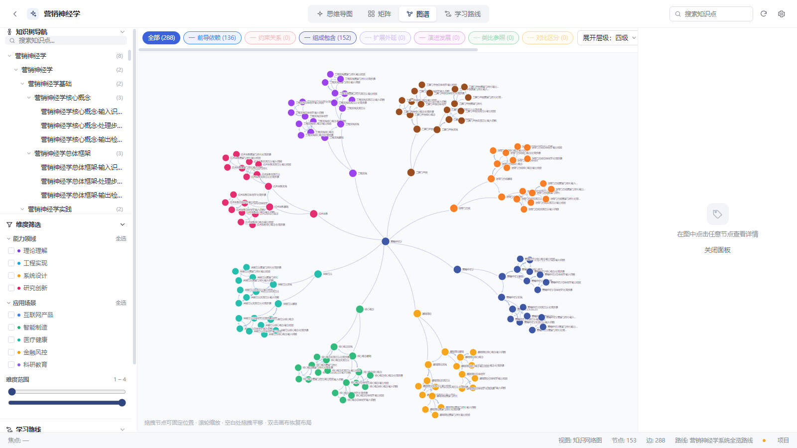
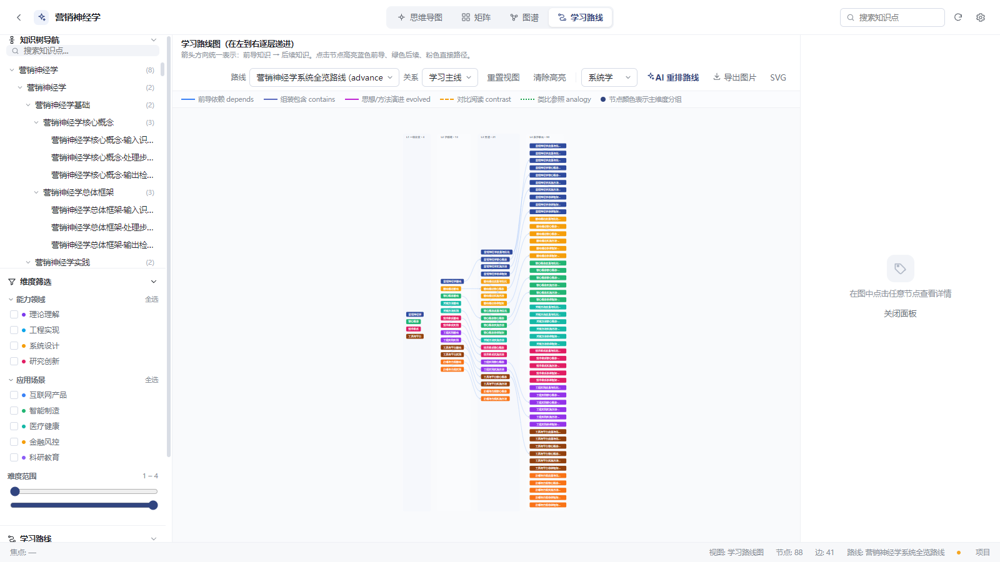

# KnowledgeViz · 知识体系可视化平台

> 输入一个领域名称，生成一整套可交互的知识体系 —— 思维导图、多维矩阵、知识图谱、学习路线四种视角，本地运行，离线可用。

[](https://www.electronjs.org/)
[](https://react.dev/)
[](https://www.typescriptlang.org/)
[](https://vite.dev/)
[](#打包成-windows-exe)
[](LICENSE)
[](https://github.com/zhoushu44/KnowledgeViz/releases/latest)

**KnowledgeViz** 是一个把「领域知识」变成「可浏览结构」的桌面应用。填入领域名称 + 描述，内置大模型会产出 5 个 KSB-YAML 文件（领域骨架 / 维度 / 知识点 / 关系类型 / 学习场景），随后你可以用四种视图从不同角度把它读透、讲清、导出。

React 18 + TypeScript + Vite + Electron 31。项目数据全部落在本地目录，除生成与联网调研外不依赖网络。

## 界面预览

| 项目列表 | 思维导图 |
| --- | --- |
|  |  |

| 多维矩阵 | 知识图谱 |
| --- | --- |
|  |  |

| 学习路线 |
| --- |
|  |

## 功能一览

| 能力 | 说明 |
| --- | --- |
| 四视图 | 思维导图（层级展开）、知识多维矩阵（行/列/筛选维度）、知识网络图谱（力导向 + 关系类型）、学习路线（入门 / 进阶 / 专家三档） |
| AI 生成 | 新建项目时填写领域名称、描述与分类，调用内置大模型生成 5 个 KSB-YAML 文件；低吞吐模型下自动降级为「骨架 + 大纲 + 本地展开」的稳定链路 |
| **联网调研** | 内置 TavilyMux 网关：深入研究、事实核查、节点资料补全、联网扩展子节点、生成时联网取证。所有请求并发执行，详见 [docs/联网调研接入说明.md](docs/联网调研接入说明.md) |
| YAML 导入导出 | 桌面版可直接导入包含 5 个 YAML 的目录；项目自动序列化落盘到本地 `projects` 目录；视图支持导出 PNG（2×）/ SVG |
| Obsidian 导出 | 一键导出为 Obsidian 知识库（含 Canvas 思维导图），默认写到「文档/Obsidian 知识库/」下，不改动你已有的库 |
| 节点学习材料 | 每个知识点自带「学习」标签页：目标、讲解小节、动手练习、常见误区、下一步；可 AI 重写并写回 YAML |
| 桌面壳 | Electron 原生窗口与中文菜单，项目以本地目录存储、可一键直达；模型请求由主进程代理（规避浏览器 CORS）；除生成时调用模型接口外，浏览与编辑全部本地完成 |
| 演示数据 | 首次启动内置多套示例知识体系（AI、金融、土木、产品经理等），开箱即可查看四视图效果 |

## 快速开始

```powershell
git clone https://github.com/zhoushu44/KnowledgeViz.git
cd KnowledgeViz
pnpm install

# 配置模型（二选一，见「配置密钥」一节）
cp .env.example .env.local      # 填入你自己的 OpenAI 兼容接口
pnpm build
pnpm start                      # 启动桌面版
```

不想装 Node？直接下载 Release 里的 `KnowledgeViz-1.0.0-portable.exe`，双击即用。

## 环境要求

| 项目 | 要求 |
| --- | --- |
| 操作系统 | Windows 10 / 11（本文命令按 PowerShell 编写；macOS / Linux 亦可运行，路径不同） |
| Node.js | ≥ 18（项目实测 Node 24.11） |
| 包管理器 | pnpm（推荐 9+，实测 10.30） |
| 桌面运行时 | Electron 31.7.7，随 `pnpm install` 安装，无需单独装 |

## 配置密钥

本仓库**不含任何密钥**。模型与联网网关都通过本地配置注入（相关文件已写进 `.gitignore`，不会误提交）：

| 能力 | 配置文件 | 环境变量 | 说明 |
| --- | --- | --- | --- |
| 内置大模型 | `.env.local` | `VITE_KSB_LLM_BASE_URL` / `VITE_KSB_LLM_API_KEY` / `VITE_KSB_LLM_MODEL` | 任意 OpenAI 兼容接口；也可在应用内「模型设置」里填（localStorage 优先） |
| 联网调研 | `electron/net.local.cjs` | `KSB_NET_BASE` / `KSB_NET_KEY` | 自建 TavilyMux 网关；不配置则该模块报错，其它功能不受影响 |

```powershell
# 模型：复制模板后按需修改
cp .env.example .env.local

# 联网调研：复制模板后按需修改
cp electron/net.local.example.cjs electron/net.local.cjs
```

> 打包给他人时不要带上这些本地文件；`pnpm dist` 只会打包 `dist/` 与 `electron/` 中的**源码**，`net.local.cjs` 若存在会被一起打入（因为它就在 `electron/` 下），分发前请删除或改用环境变量。

## 安装与命令

```powershell
# 安装依赖（首次）
pnpm install
```

| 命令 | 作用 |
| --- | --- |
| `pnpm dev` | 启动 Vite 开发服务器（http://localhost:5173，strictPort） |
| `pnpm build` | **类型检查 + 构建**：`tsc -b --noEmit && vite build`，产物在 `dist/` |
| `pnpm build:web` | 仅执行 `vite build`（跳过类型检查，产出纯 Web 版） |
| `pnpm preview` | 本地预览已构建的 Web 产物 |
| `pnpm typecheck` | 只做类型检查：`tsc -b --noEmit` |
| `pnpm start` | 启动桌面应用（`node scripts/launch.cjs`，读取 `dist/`，需先 `pnpm build`） |
| `pnpm start:dev` | 开发模式：先起 Vite，就绪后启动 Electron 并加载 `http://localhost:5173` |
| `pnpm debug` | 以调试模式启动（`--remote-debugging-port=9444`），可接 DevTools / Puppeteer |
| `pnpm electron` | 直接 `electron .`（等价底层入口，不做环境变量清理） |
| `pnpm electron:dev` | `pnpm start:dev` 的别名（原实现依赖未安装的 concurrently / wait-on，已改为复用无依赖脚本） |
| `pnpm dist` | **打 Windows exe**：类型检查 + 构建 + electron-builder，产出 `release/` 下的安装包与便携版 |
| `pnpm dist:dir` | 只产出免安装目录 `release/win-unpacked/`（调试打包配置时用，不生成 exe） |

> `start:dev` 未使用 `concurrently` / `wait-on`（本项目**不新增依赖**，这两个包当前也未安装）：脚本用 `node:http` 轮询 `http://localhost:5173` 直到返回响应，再 `spawn` `scripts/launch.cjs --dev`，并在 Electron 退出时回收 Vite 进程。若你之后自行安装了这两个包，也可换成
> `concurrently -k "vite" "wait-on http://localhost:5173 && node scripts/launch.cjs --dev"`。

常用流程：

```powershell
# 开发调试（热更新）
pnpm start:dev

# 生产构建 + 启动桌面版
pnpm build
pnpm start

# 排查渲染进程问题：先 pnpm debug，再用 Chrome 打开
#   http://127.0.0.1:9444/json    （或 chrome://inspect 连接 9444）
pnpm debug
```

`scripts/launch.cjs` 会清掉可能继承的 `ELECTRON_RUN_AS_NODE`，避免 `electron.exe` 退化成 Node 解释器；`--dev` 参数会注入 `VITE_DEV_SERVER_URL`。

## 打包成 Windows exe

```powershell
pnpm dist
```

产物（`release/`，本地文件名带中文，上传 GitHub Release 时改名为 ASCII）：

| 文件 | 说明 |
| --- | --- |
| `KnowledgeViz-1.0.0-setup.exe` | NSIS 安装包，约 76 MB；可选安装目录、建桌面与开始菜单快捷方式，带卸载程序（打包产物名为 `知识体系可视化平台-1.0.0-安装包.exe`） |
| `KnowledgeViz-1.0.0-portable.exe` | 单文件便携版，约 76 MB；双击即用，不写注册表、不需安装（打包产物名为 `知识体系可视化平台-1.0.0-便携版.exe`） |
| `win-unpacked/` | 解包目录，可直接运行 `知识体系可视化平台.exe`，用于排查打包问题 |

### 下载

| 版本 | 链接 |
| --- | --- |
| 安装版 | [KnowledgeViz-1.0.0-setup.exe](https://github.com/zhoushu44/KnowledgeViz/releases/download/v1.0.0/KnowledgeViz-1.0.0-setup.exe) |
| 便携版 | [KnowledgeViz-1.0.0-portable.exe](https://github.com/zhoushu44/KnowledgeViz/releases/download/v1.0.0/KnowledgeViz-1.0.0-portable.exe) |

SHA-256：

```text
KnowledgeViz-1.0.0-setup.exe     2ca54cd379279c8027100f1a8a6420244cf0d9f0631209d73a62d6d45b053880
KnowledgeViz-1.0.0-portable.exe  201af224a5aebfa808adeb5559dac102f29bb16e535582c78029a63fe7e17166
```

打包配置在 `package.json` 的 `build` 字段，图标为 `build/icon.ico`。`electron-builder` 已作为 devDependency 安装；国内网络下首次打包若卡在下载 Electron 二进制，可先设 `ELECTRON_MIRROR=https://npmmirror.com/mirrors/electron/`。

> 安装版与便携版共用同一个用户数据目录 `%APPDATA%\knowledge-viz\projects`（由原 `name` 决定，与是否改名无关），因此两者看到的是同一批项目；换机器只需拷贝该目录。

> Release 附件里没有放二进制到 git 仓库：exe 通过 `gh release upload` 之类的方式挂到 Release 下（GitHub 单文件上限 2 GB，本项目约 76 MB 无压力），仓库本体保持轻量。重新发版时把 `release/` 里两个 exe 用 ASCII 名上传即可。

## 目录结构

```text
knowledge-viz/
├─ src/
│  ├─ pages/                # HomePage（项目列表）、CreatePage（AI 生成）、WorkspacePage（四视图工作台）
│  ├─ views/                # MindMapView、MatrixView、GraphView、RouteView
│  ├─ components/           # TreeNav、NodeDetail、DimensionFilter、GlobalSearch、ImportModal、
│  │                        # ProjectSettingsModal、ModelSettingsModal、Icons
│  ├─ lib/                  # llm.ts（模型配置/调用）、ksb.ts（YAML 解析校验序列化）、
│  │                        # generate.ts（生成链路）、prompt.ts（内置提示词）、export.ts、desktop.ts、types.ts
│  ├─ data/                 # ai.ts、minis.ts（内置示例知识体系）
│  ├─ store/                # projects.tsx（项目状态 + 落盘）、router.tsx（hash 路由）
│  └─ styles/               # tokens.css、app.css
├─ electron/                # main.cjs（主进程：窗口/菜单/projects 读写/LLM 代理）、preload.cjs（contextBridge）、net.cjs（联网调研）
├─ build/                   # icon.ico（electron-builder 打包图标）
├─ docs/                    # 联网调研接入说明、AI 调整对话框设计、screenshots/
├─ release/                 # pnpm dist 产物：安装包 / 便携版 / win-unpacked（已 gitignore）
├─ scripts/                 # launch.cjs、debug-launch.cjs、smoke.mjs、verify-*.mjs
├─ index.html
├─ vite.config.ts           # base: './'，端口 5173，产物 dist/
├─ tsconfig.json            # strict、noEmit
└─ package.json
```

关键目录职责：

| 目录 | 职责 |
| --- | --- |
| `src/pages/` | 三个页面级组件：项目列表（首页）、AI 生成（创建页）、四视图工作台 |
| `src/views/` | 四个可视化视图，各自负责渲染、缩放、筛选与导出 |
| `src/components/` | 通用 UI：树导航、节点详情、维度筛选、全局搜索、导入弹窗、项目/模型设置 |
| `src/lib/` | 纯逻辑层：模型调用、YAML 解析校验、生成链路、提示词、导出、桌面桥接与类型定义 |
| `src/data/` | 内置示例知识体系（首次启动的演示数据） |
| `electron/` | 桌面壳主进程与预加载脚本（文件读写、原生菜单、LLM 请求代理、联网调研引擎） |
| `scripts/` | 启动、调试启动、冒烟与生成链路校验脚本（`pnpm debug` 后可用 CDP 复跑） |

## 数据格式：KSB-YAML 五文件

一个项目 = 一个目录 + 固定 5 个 YAML 文件，文件名为硬约定（缺一不可）：

| 文件 | 作用 | 关键内容 |
| --- | --- | --- |
| `domain.yaml` | 领域元信息与顶层骨架 | `domain.id / name / name_en / category / description`，`layers`（L1–L4 四层），`branches`（8 个一级分支，含 `color`） |
| `dimensions.yaml` | 视觉维度定义（矩阵的行 / 列 / 筛选器） | `dimensions[]`：`role` 取 `row` / `column` / `filter`，每个维度有 `values[]`（`id` + `name` + 可选 `color`） |
| `knowledge_points.yaml` | 知识节点主体（体系的 90% 内容） | `knowledge_points[]`：`id / name / level(root 或 L1–L4) / branch / parent / definition / description / difficulty(1–4) / importance(0–100) / centrality(0–100) / study_minutes / tags / dimensions / prerequisites` |
| `relation_types.yaml` | 关系类型的名称与画法 | `relation_types[]`：`depends / contains / constrains / extends / evolved / analogy / contrast` 七种，含 `color / style / arrow / directed` |
| `scenarios.yaml` | 学习路线（场景化学习顺序） | `scenarios[]`：`id / name / level / node_count / description / stages[]`，`level` 取 `beginner`–`expert`，每阶段含 `name / layer / nodes[]` |

`knowledge_points.yaml` 片段示例：

```yaml
knowledge_points:
  - id: b3_l3_1_1
    name: 需求分析
    name_en: Requirements Analysis
    level: L3
    branch: b3
    parent: b3_l2_1
    definition: 把业务目标拆解为可验证的系统需求。
    difficulty: 3
    importance: 82
    dimensions: { stage: core, field: f3, ability: [a3] }
    prerequisites: [b3_l2_1]
```

> 示例省略了 `description / centrality / study_minutes / tags` 等字段（均为可选或带默认值）；`root` 是整棵树的根，`L1` 对应 8 个分支，每个 `L3` 方法再拆 3 个 `L4` 原子单元（input / process / output）。

解析时的硬性校验（`src/lib/ksb.ts`）：

- 分支数 ≥ 5，节点数 ≥ 30；
- `id` 全局唯一，`branch / parent / prerequisites / 路线节点` 必须引用已存在的 id；
- `difficulty` ∈ 1–4，`importance / centrality` ∈ 0–100；
- 前导依赖不得成环；每个分支至少 1 个 L4 原子单元；
- 节点 `dimensions` 的键值必须能在 `dimensions.yaml` 中找到（导入严格模式）。

## 项目存放位置

桌面版把每个项目写成独立目录，路径由 Electron 的 `app.getPath('userData')` 决定：

```text
<userData>/projects/<项目名>/
├─ domain.yaml
├─ dimensions.yaml
├─ knowledge_points.yaml
├─ relation_types.yaml
└─ scenarios.yaml
```

Windows 上即：

```text
%APPDATA%\knowledge-viz\projects
# 展开后通常是 C:\Users\<用户名>\AppData\Roaming\knowledge-viz\projects
```

应用菜单 **File → 打开项目目录**（Help 菜单里也有同名项）可直接在资源管理器中打开该目录；Help → 关于 会显示当前真实的绝对路径。项目列表与最后打开位置另存于浏览器 `localStorage`（`ksb.projects.v1`、`ksb.last.v1`），磁盘目录为权威来源，启动时会自动合并。

## 内置大模型

| 项 | 值 |
| --- | --- |
| 协议 | OpenAI 兼容（`POST {baseUrl}/chat/completions`） |
| 接口地址 | 由 `VITE_KSB_LLM_BASE_URL` 或应用内「模型设置」提供，仓库内不含真实地址 |
| 默认模型 | `deepseek-v4-flash`（可用 `VITE_KSB_LLM_MODEL` 覆盖） |
| 调用位置 | Electron 主进程代理（`electron/main.cjs` 的 `llmChat`），渲染进程经 `window.ksbLlm` 调用 |
| 默认参数 | `temperature 0.3`、`max_tokens 4000`、`stream: false`、关闭思维链（`chat_template_kwargs.enable_thinking = false`） |
| system 处理 | **部分 OpenAI 兼容代理会静默丢弃 `system` 消息**，`llm.ts` 默认把 system 指令折叠进首条 user 消息（`mergeSystemIntoUser: true`）；换到正常接口时置 `false` 即可 |

修改方式（二选一，均不需要改构建配置）：

1. **界面改（推荐）**：首页 →「模型设置」，可改接口地址 / API Key / 模型名 / 温度 / max_tokens / 是否流式，保存后写入 `localStorage` 键 `ksb.llm.v1`（只覆盖改动项，不修改源码默认值）。内置预设：`deepseek-v4-flash`（快）、`minimax-m3.1-flash`（备用）、`stepfun-ai/step-5-preview`（质量高但慢）、`z-ai/glm-5.3-flash`。
2. **改默认值**：在 `.env.local` 里写 `VITE_KSB_LLM_BASE_URL` / `VITE_KSB_LLM_API_KEY` / `VITE_KSB_LLM_MODEL`，重新 `pnpm build` 生效；也可直接编辑 `src/lib/llm.ts` 的 `DEFAULT_LLM`。

`localStorage` 中的结构（在 DevTools → Application → Local Storage 手动写入同样生效）：

```json
{
  "baseUrl": "https://your-gateway.example.com/v1",
  "apiKey": "<你的 key>",
  "model": "deepseek-v4-flash",
  "temperature": 0.3,
  "maxTokens": 4000,
  "stream": false
}
```

> 该代理对 SSE 分块较慢，生成链路固定用非流式整包返回（比流式快 2–3 倍）；开启 `stream` 反而容易超时。

## 已知限制

- **生成降级会弹窗**：模型超时/不可用或用尽 token 时，骨架会回退到内置模板（分支为「基础理论/核心概念/关键方法」这类通用词），此时生成完成后会弹窗明确告知是「领域骨架」还是「部分分支大纲」被降级，可直接重试。
- **生成耗时**：内置模型吞吐较低，一次完整生成约 **2–6 分钟**（界面会显示骨架 / 大纲 / 组装 / 校验阶段进度），请勿中途关闭窗口；生成可随时取消。
- **校验回退**：模型输出的 YAML 若校验失败或不可用（骨架缺失、分支/大纲不全、字段与引用不合法），生成链路会**回退为内置知识树模板**（本地八分法骨架 + 通用子领域/方法补齐），保证仍能出图；此时内容偏通用，建议重试或改用 YAML 导入。若回退后硬校验仍不通过，界面会列出具体校验问题（文件 + 行号）。
- **浏览器模式受限**：`pnpm dev` / `pnpm preview` 下没有 Electron 主进程代理，模型请求可能被 CORS 拦截，且无法读写本地 `projects` 目录；完整能力请用 `pnpm start`。
- **导入较严**：目录导入按严格模式校验，节点少于 30 或分支少于 5 会被拒绝；确需宽松导入可用代码内的 `parseBundle(..., { loose: true })`。
- 项目数据同时存于 `localStorage` 与磁盘，清空浏览器数据后需靠 `projects` 目录重新载入。
- **密钥需自备**：仓库不含任何接口地址与 key，首次运行前必须按「配置密钥」一节注入，否则 AI 生成与联网调研不可用。
- **exe 未签名**：安装包 / 便携版均无代码签名，首次运行 Windows SmartScreen 会提示「未知发布者」，需手动允许。

## 节点学习内容（v2）

「节点详情」的**学习**标签页把每个知识点变成可直接照着学的一段材料。v2 的核心变化是：
**先把「占位/空话」和「真材料」在界面上分开，再谈生成。**

| 能力 | 说明 |
| --- | --- |
| 内容质检 | 面板顶部常驻分数条（0–100）：`可学 / 偏薄 / 占位·空话`。逐项检查：小节字数、是否有具体物（术语/实验/数字/公式）、是否命中空话词典、是否只是把定义抄一遍、练习是否可执行。编辑时实时变分 |
| 内置体检单 | 打开即有一份 **体检单（不是学习材料）**，明确标注 `source: template` 并压到 12–35 分。它只做三件事：引用本节点真实定义、列出真实结构位置（上级路径 / 子节点 / 前置 / 下游）、给出缺口清单（定义退化、无描述、无示例、无资源、无子节点…） |
| 定义退化提示 | 当「详细描述」与「定义」完全相同、或定义只是标题改写时，面板直接点名，并（AI 重写后）给出**建议定义**，可一键写入节点 —— 否则任何学习内容都建在空定义上 |
| AI 重写 | 联网取证（3 个角度检索 + 抓前 2 篇正文）→ 按硬约束生成 → **质检 <75 自动回炉一次**。提示词强制：每节必含具体物、禁用 15 个空话词、字数预算、必写「什么时候不适用」 |
| 依据可追溯 | 生成时用到的 URL 存在 `learning.sources`，界面「📎 依据」可点开，导出 Markdown 也带上 |
| 全字段可编辑 | 目标、讲解小节（可增删，带字数提示）、练习、误区、下一步都能改；编辑态展示质检问题清单（错误红 / 警告黄） |
| 持久化 | 保存后写回 `knowledge_points.yaml` 的 `learning` 字段，刷新/重开仍在 |
| 导出 | 「导出」把当前节点学习内容存成 Markdown（含质检分与依据） |

`learning` 字段结构：

```yaml
learning:
  goals: ["学完能做到 A", "学完能做到 B"]
  sections:
    - { title: 它到底是什么, body: 120-200 字，必含具体物 }
    - { title: 怎么用 / 怎么运作, body: 分步骤 + 阈值 }
    - { title: 什么时候不适用, body: 边界 + 真实失败案例 }
  practice: 一个 20-30 分钟能完成、产出可检查物件的练习
  pitfalls: [真实易错点 1, 真实易错点 2]
  further: [延伸 1, 延伸 2]
  sources: ["https://…"]        # 联网取证依据（可选，≤5 条）
  source: ai | manual | template
  updated_at: 2026-11-04T02:00:00.000Z
```

> 生成器另有两处针对真实模型的修补：① 模型撞 `max_tokens` 被截断时，`closeTruncatedJson` 逐级裁掉残项并补齐括号，仍能救回前几节；② 残留小节不足 2 节则明确报错而不是塞半截内容。

## 已验证项（本机实测）

| 项目 | 结果 |
| --- | --- |
| `pnpm typecheck` / `pnpm build` | 通过，0 错误 |
| 导出 exe 之外的桌面启动 `pnpm start` | 通过，窗口标题「知识体系可视化平台」 |
| AI 生成（企业架构 / 数据治理两个领域） | 通过：153 节点 / 288 边 / 3 条路线，5 个 YAML 已写入 `%APPDATA%\knowledge-viz\projects\<项目名>\` |
| 四视图渲染 | 通过：思维导图 25（折叠二级）/ 矩阵全量 / 图谱 153 节点 288 边 / 学习路线 94 节点 48 边 |
| 交互冒烟（`node scripts/smoke.mjs`） | 14 项全 PASS：首页、模型设置、卡片、顶栏、树、导图、四视图切换、Ctrl+K 搜索、维度筛选（降透明度 + URL 持久化）、项目设置、导入弹窗、模板下载 |
| 节点学习内容 | 通过：质检条 19→92、体检单无套话、定义缺口卡、编辑态问题清单、保存后写回 YAML 并可重新解析（`scripts/verify-learning.mjs` 浏览器 CDP / `scripts/verify-learning-ai.mjs` Electron 真模型） |
| 学习内容真模型实测 | 通过：「营销神经学实践」19 分 → 29.3s 生成 → 92 分（3 节 / 3 目标 / 3 误区），含 Robinson 1965、Forgy 1982、RETE 等真实术语与「什么时候不适用」边界，`learning.sources` 落盘 2 条依据 |
| 打包 exe | 通过：`pnpm dist` 产出 `release/知识体系可视化平台-1.0.0-安装包.exe` 与 `-便携版.exe`（各约 76 MB），安装 / 卸载 / 便携版启动、四视图渲染均正常 |
| 思维导图样式 | L1 实心胶囊 + L2–L4「左侧竖线 + 下划线」无边框文字，列宽按最长节点自适应（与参考图一致） |
| 第一性原理命名 | 骨架分支输出「价值 V / 成本&损失通路 / 奖赏通路」式分项，L2 为「机制名-系统1/2」，L3 为「线索-怎么看」；实测 5–26s 完成，思维链归零 |

> 回归截图：`pnpm debug` 起 9444 调试端口后，按 `scripts/verify-*.mjs` 里的 CDP 写法自建脚本即可（一次性截图脚本已清理）。

## 技术栈

| 层 | 选型 |
| --- | --- |
| UI | React 18 + TypeScript（strict）+ 手写 CSS 变量主题 |
| 可视化 | `d3-hierarchy`（思维导图）、`d3-force`（力导向图谱）、`d3-shape`（关系曲线）、自绘矩阵与路线图 |
| 数据层 | `js-yaml` 解析 / 校验 / 序列化 KSB-YAML 五文件 |
| 构建 | Vite 5（`base: './'`，产物可被 `file://` 直接加载） |
| 桌面 | Electron 31，`contextBridge` 暴露最小 IPC 面，主进程代理模型请求与文件读写 |
| 打包 | electron-builder 26（NSIS 安装包 + 单文件便携版） |

## 设计要点

- **以 YAML 为契约**：AI 只负责产出结构化 YAML，四个视图都从同一份数据渲染，互相不耦合；因此也可以手工编写或用脚本批量生成项目。
- **生成链路可降级**：模型输出不合格时自动回退到本地骨架 + 本地展开，保证任何时候都能出图，而不是白屏报错。
- **主进程代理一切外部请求**：渲染进程不直接联网，既绕开 CORS，也让密钥集中在主进程、不进 `localStorage` 以外的暴露面。
- **零依赖装饰**：图标、图形、主题全部手写 SVG / CSS，没有引入 UI 组件库，安装包才 76 MB（Electron 本体占大头）。

## 贡献

欢迎提 Issue / PR。改动前端后请至少跑一遍：

```powershell
pnpm typecheck
pnpm build
node scripts/smoke.mjs   # 需先 pnpm build && pnpm start（或 preview）
```

## 许可证

[MIT](LICENSE) © 2026 zhoushu44

## 致谢

- 交互与视觉参考了 B 站公开演示视频的结构拆解（仅借鉴布局思路，未使用其素材）
- 感谢 `d3`、`js-yaml`、`vite`、`electron` 等开源项目
